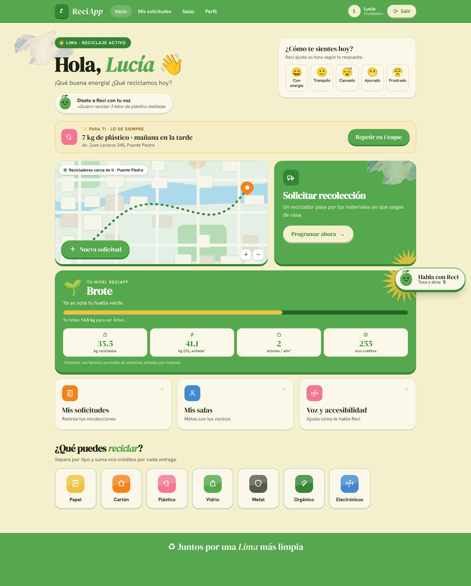
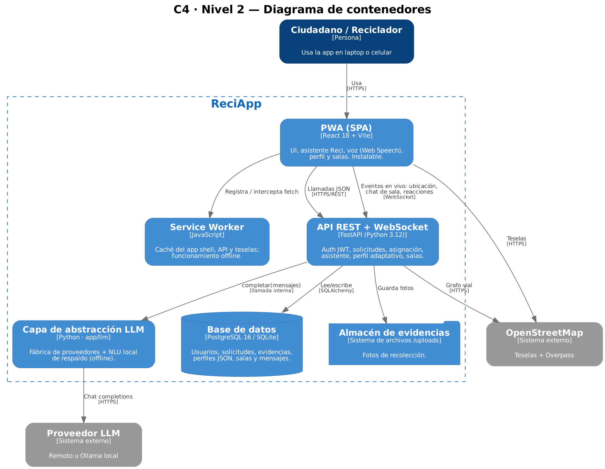

# ♻ ReciApp: reciclaje con voz, en comunidad

**Curso:** CC451 Interacción Humano Computador · UNI · 2026-2
**Entrega actual:** Práctica Calificada 03, prototipo funcional al ~80 % ([estado](docs/ESTADO-PC3.md))
**Repositorio:** https://github.com/sebaswaton/PC2-IHC
**Equipo:** Sebastian Sergio Ninasivincha · Darcy Ortega Sullcaccori · Giordano Daniel Medrano Cangalaya · Erick Daniel Ortega Moran
**Licencia:** [MIT](LICENSE)

ReciApp es una **PWA** que conecta a vecinos de Puente Piedra (Lima) con recicladores formales. El ciudadano puede **hablarle a "Reci"**, un asistente de voz con LLM: le dice *"quiero reciclar 3 kilos de plástico mañana por la tarde"* y Reci prepara la solicitud con lo que ya sabe de él. Luego puede seguir al reciclador en vivo y **reciclar en comunidad** dentro de salas con metas compartidas.



---

## Requerimientos comunes de la PC2: dónde está cada uno

| Requerimiento | Implementación | Archivos clave |
|---|---|---|
| **Interfaz de voz** | Dictado (STT, `es-PE`) y lectura en voz alta (TTS) con Web Speech API. Onda de volumen en vivo y comandos de voz de accesibilidad ("letra más grande", "habla más lento", "léeme en voz alta"). El chat de las salas también acepta dictado. Hay alternativa por texto en todos los casos. | `reciapp-frontend/src/hooks/useVoz.js`, `src/components/Reci/AsistenteReci.jsx` |
| **LLM con capa de abstracción** | La interfaz `LLMProvider` admite 7 proveedores: **local** (offline, sin API key), OpenAI, Groq, OpenRouter, **Ollama (local)**, Anthropic y Gemini. Se cambia de proveedor con `LLM_PROVIDER`. Si el proveedor remoto falla, se usa automáticamente el NLU local. | `reciapp-backend/app/llm/` (`base.py`, `providers.py`, `factory.py`, `nlu.py`) |
| **Plataforma PWA** | Manifest con íconos maskable y atajos, y service worker (app shell, API y teselas en caché, modo offline). Incluye aviso de instalación, indicador "sin conexión" y fuentes empaquetadas para que funcione sin internet. | `public/manifest.webmanifest`, `public/sw.js`, `src/components/PWA/BarraPWA.jsx` |
| **Personalización continua** | Perfil persistente (JSON) que se actualiza con cada evento: materiales, franja y dirección habituales, **ritmo** (segundos por solicitud y por paso), **errores** (3 en 5 min se interpretan como frustración) y **emociones** declaradas o inferidas del texto. De ahí se derivan el tono del asistente, la velocidad de la voz, el nivel de guía y el autocompletado. | `app/services/perfil_adaptativo.py`, `src/context/PerfilContext.jsx`, `src/components/Perfil/PanelAccesibilidad.jsx` |
| **Multiusuario** | **Salas** de barrio, condominio, colegio o empresa con código de invitación, meta común en kg, ranking, chat en tiempo real (WebSocket), reacciones, indicador "escribiendo…" y mensajes de logro automáticos cuando un miembro completa un recojo. | `app/api/v1/salas.py`, `app/services/salas.py`, `src/pages/Salas.jsx`, `src/pages/SalaDetalle.jsx` |
| **Diseño emocional (Norman)** | **Visceral:** mascota Reci con 7 expresiones, starbursts y paleta cálida. **Conductual:** micro-interacciones (botones 3D, vibración háptica, sacudida ante errores, confeti, toasts). **Reflexivo:** nivel Semilla → Bosque, CO₂ evitado y árboles equivalentes, check-in "¿Cómo te sientes hoy?" y tono del asistente adaptado (empático, cálido, festivo…). | `src/components/Reci/ReciMascota.jsx`, `src/components/Emocion/*`, `src/styles/reciapp.css` |

## Novedades de la PC3

| Funcionalidad | Qué resuelve | Dónde |
|---|---|---|
| **Jornadas de recojo compartidas** | Los vecinos de una sala organizan un recojo colectivo: cada uno se suma con su material, un reciclador lo toma y al completarlo se acreditan los eco-créditos y la meta de la sala | `app/api/v1/jornadas.py`, `src/components/Salas/JornadasSala.jsx` |
| **Cola offline de acciones** | Sin señal, la solicitud o el mensaje se guardan en el celular y se envían solos al volver la red | `src/lib/colaOffline.js`, `src/components/PWA/SincronizadorGlobal.jsx` |
| **Notificaciones del sistema** | Avisos del sistema operativo (vía service worker) cuando aceptan el recojo, el reciclador va en camino o hay novedades en la sala | `src/lib/notificaciones.js`, `public/sw.js` |
| **Encuesta SUS en la app** | Mide la satisfacción (System Usability Scale) con una pregunta por pantalla, botones grandes y lectura en voz alta | `src/pages/EncuestaSUS.jsx`, `app/api/v1/usabilidad.py` |
| **Panel de métricas (admin)** | Compara el uso con los criterios de usabilidad: SUS ≥ 75, voz ≤ 45 s, táctil ≤ 90 s, ≤ 1 error por tarea | `src/pages/AdminMetricas.jsx` |
| **Evaluación del NLU** | Corpus de 80 frases etiquetadas (60 de desarrollo y 20 de prueba): **80 % de precisión en prueba** (meta 85 %, aún no se cumple) | `app/evaluacion_nlu.py`, [docs/evaluacion-nlu.md](docs/evaluacion-nlu.md) |
| **Auditoría de accesibilidad** | axe-core en 9 pantallas: de **160 a 1** nodos con violación WCAG 2.1 AA | [docs/accesibilidad/](docs/accesibilidad/README.md) |

Evidencias (capturas y video de 77 s): [`docs/evidencias-pc3/`](docs/evidencias-pc3/).

## Estructura del repositorio

```
.
├── README.md · LICENSE · docker-compose.yml
├── reciapp-backend/        FastAPI + SQLAlchemy (PostgreSQL o SQLite)
│   ├── app/llm/            capa de abstracción LLM + NLU local
│   ├── app/services/       asistente, perfil adaptativo, impacto, salas, ruteo, asignación
│   ├── datos_simulados/    usuarios, solicitudes, salas, perfiles y fotos de evidencia (JSON/PNG)
│   └── tests/              63 pruebas (pytest)
├── reciapp-frontend/       React 18 + Vite (PWA)
└── docs/
    ├── INSTALACION.md      guía de instalación (Docker, laptop sin Docker, celular)
    ├── ARQUITECTURA.md     C4 nivel 1, 2 y 3 (Mermaid + PNG/SVG)
    ├── arquitectura/       diagramas C4 renderizados
    ├── diagramas/          flujo entre pantallas y Gantt
    ├── prototipos/         3 alternativas de diseño
    ├── simulacion/         capturas del flujo completo + video (simulacion-flujo.mp4)
    ├── Informe-Avance-PC2.docx
    ├── Informe-Avance-PC3.docx · Guion-Video-PC3.docx · ESTADO-PC3.md
    ├── evidencias-pc3/     capturas + video de la PC3 · accesibilidad/ · evaluacion-nlu.md
    └── aportes/            mi-aporte-<nombre-apellido>.docx de cada integrante
```

## Inicio rápido

**Opción A: Docker (todo en un comando)**
```bash
docker compose up --build
# Web: http://localhost:4173 · API/Swagger: http://localhost:8000/docs
```

**Opción B: laptop sin Docker (SQLite)**
```bash
# Backend
cd reciapp-backend
python -m venv .venv && source .venv/bin/activate     # Windows: .venv\Scripts\activate
pip install -r requirements.txt
cp .env.example .env    # y cambia DATABASE_URL=sqlite:///./reciapp.db
python -m app.seed      # carga los datos simulados
uvicorn app.main:app --reload

# Frontend (otra terminal)
cd reciapp-frontend
npm install
cp .env.example .env
npm run dev             # http://localhost:5173
```

Los detalles (probar en el celular, instalar la PWA, cambiar de LLM) están en **[docs/INSTALACION.md](docs/INSTALACION.md)**.

### Cuentas de demostración (contraseña `Reciapp2026!`)

| Correo | Rol | Perfil simulado |
|---|---|---|
| `lucia@reciapp.pe` | Ciudadana | Usuaria frecuente de voz; anfitriona de la sala "Vecinos de Santa Rosa" |
| `rosa@reciapp.pe` | Ciudadana | Adulta mayor con baja visión: letra muy grande, alto contraste, lectura en voz alta |
| `jorge@reciapp.pe` | Ciudadano | Persona sorda: voz desactivada, usa solo texto y feedback visual/háptico |
| `miguel@reciapp.pe` | Ciudadano | Usuario de silla de ruedas; frustración inferida que activa el tono empático |
| `carlos@reciapp.pe` | Ciudadano | Usuario experto y rápido (modo "experto") |
| `ana@reciapp.pe` | Ciudadana | Docente, anfitriona de la "Brigada Verde" del colegio |
| `juan.reciclador@reciapp.pe` | Reciclador | Aprobado, con solicitudes en camino |
| `admin@reciapp.pe` | Admin | Valida recicladores pendientes |

### Para probar en 2 minutos
1. Entra como **lucia@reciapp.pe**, toca **"Habla con Reci"** y di o escribe *"quiero reciclar 4 kilos de papel"*. Reci completa la franja y la dirección desde tu perfil ✨. Pulsa **Confirmar**.
2. Escribe *"¿cuál es mi impacto?"*, *"letra más grande"* o *"estoy harto, no funciona"* y fíjate cómo cambian el tono y la mascota.
3. Abre **Salas → Vecinos de Santa Rosa** en dos navegadores (Lucía y Carlos) y chatea: los mensajes, las reacciones y el "escribiendo…" llegan en vivo.
4. Ejecuta `npm run build && npm run preview` y **instala la PWA** desde el navegador.

## Cambiar de proveedor LLM

```bash
# reciapp-backend/.env
LLM_PROVIDER=ollama   LLM_MODEL=llama3.2:3b   LLM_BASE_URL=http://localhost:11434/v1   # 100 % local
LLM_PROVIDER=groq     LLM_MODEL=llama-3.1-8b-instant   LLM_API_KEY=gsk_...
LLM_PROVIDER=openai   LLM_MODEL=gpt-4o-mini            LLM_API_KEY=sk-...
LLM_PROVIDER=anthropic LLM_MODEL=claude-haiku-5-5      LLM_API_KEY=sk-ant-...
LLM_PROVIDER=gemini   LLM_MODEL=gemini-2.0-flash       LLM_API_KEY=...
```
La interfaz muestra en el encabezado de Reci qué proveedor respondió (por ejemplo, `LLM · local` o `LLM · groq (respaldo)`).

## Arquitectura

Resumen C4 (detalle en [docs/ARQUITECTURA.md](docs/ARQUITECTURA.md)):



## Pruebas

```bash
cd reciapp-backend && pip install -r requirements-dev.txt && pytest -q   # 63 passed
cd reciapp-frontend && npm run build
```

## Documentación de la PC2
- Informe completo: stakeholders, PACT, HU, RF/RNF, matriz de trazabilidad, sistemas similares, criterios de usabilidad, 3 alternativas, Gantt, flujo de pantallas y simulación → `docs/Informe-Avance-PC2.docx`
- Simulación del flujo: `docs/simulacion/` (capturas numeradas + `simulacion-flujo.mp4`)
- Aportes individuales: `docs/aportes/` (también en la raíz del zip)
- Reporte PC3 (evidencia por HU y requerimiento): `docs/Informe-Avance-PC3.docx`
- Guion del video PC3 (3 min por integrante): `docs/Guion-Video-PC3.docx`
