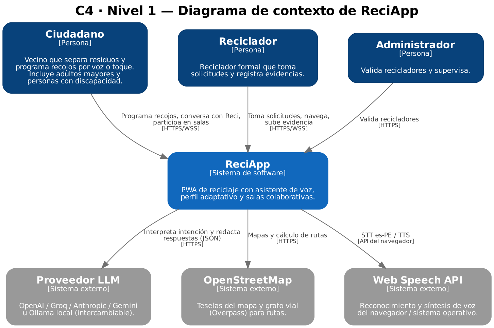
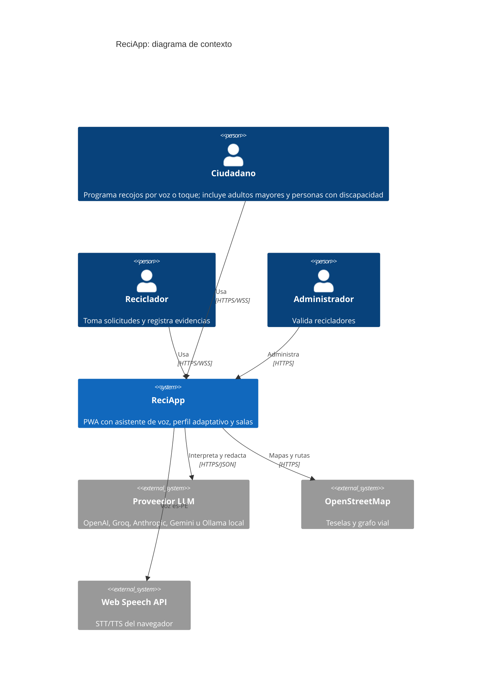
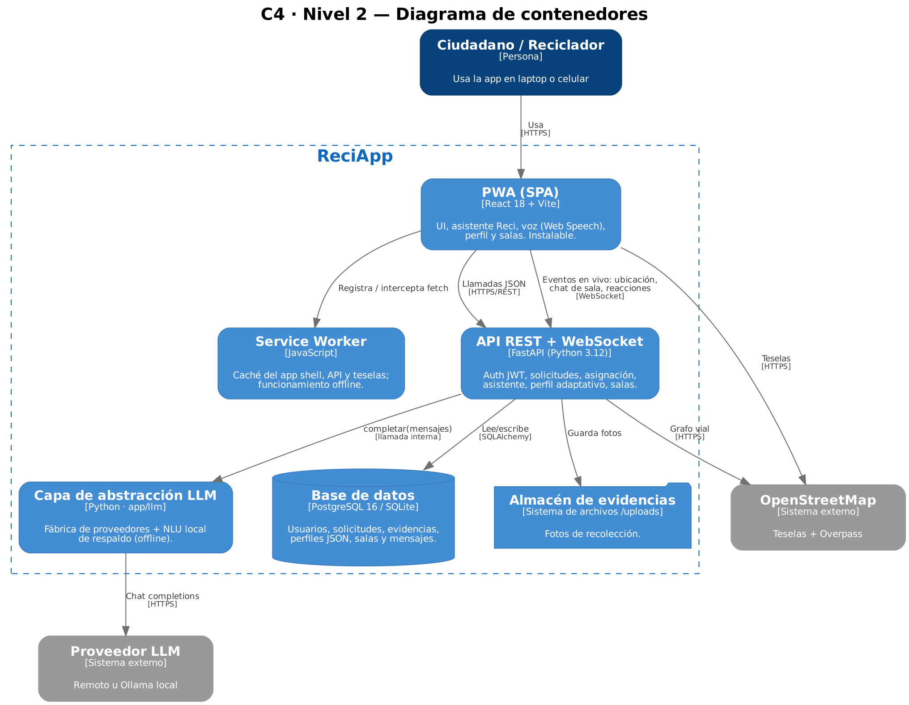
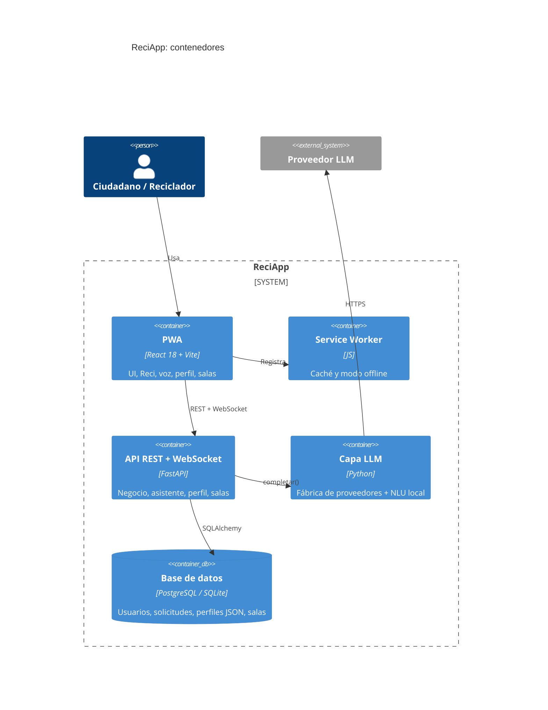
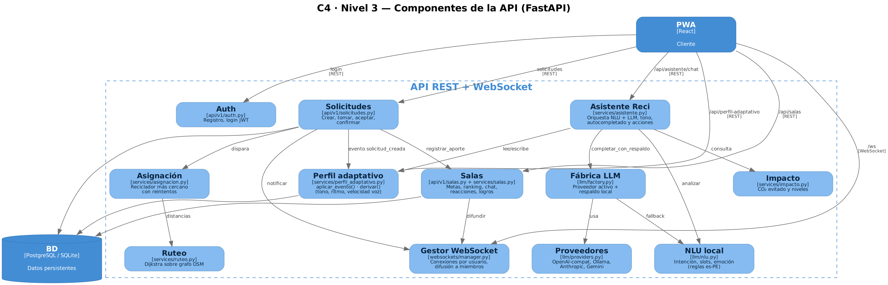

# Arquitectura: modelo C4

Los diagramas renderizados están en [`docs/arquitectura/`](arquitectura/) (PNG/SVG, generados con Graphviz desde los `.dot`). Abajo va la versión en Mermaid, que GitHub muestra directamente.

## Nivel 1: Contexto

## Nivel 2: Contenedores

## Nivel 3: Componentes de la API

## Decisiones de diseño
| Decisión | Motivo |
|---|---|
| **El NLU local siempre corre**, aunque haya un LLM remoto | Respuesta determinista para los *slots* (material, kg, día, franja), el sistema sigue funcionando sin internet o sin cuota, y no hay costo en la demo. |
| **El LLM debe devolver JSON** con `intencion`, `slots`, `emocion` y `respuesta` | Lo validamos y lo fusionamos con el NLU. Si el JSON es inválido, se usa el NLU sin romper el flujo. |
| **Perfil como documento JSON** + función pura `aplicar_evento` | Esquema evolutivo (se completan las claves nuevas) y comportamiento adaptativo 100 % testeable. |
| **STT/TTS en el navegador** | Sin costo ni latencia de servidor y con privacidad (el audio no sale del dispositivo en Chrome con reconocimiento local). Si no hay soporte, hay alternativa por texto. |
| **WebSocket único por usuario** reutilizado para tracking y salas | Menos conexiones; el gestor ya soporta varias pestañas. |
| **SQLite opcional** | La app corre en cualquier laptop sin instalar PostgreSQL (Nota 2 del enunciado). |
